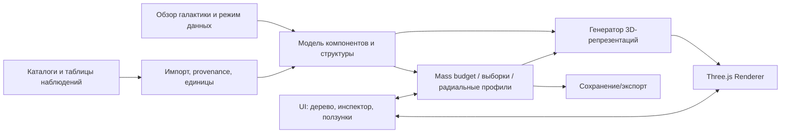

# Техническое задание: Galaxy Explorer

**Документ:** техническое задание / product & engineering specification  
**Версия:** 0.1 (проектирование, без реализации)  
**Дата:** 15 октября 2026 г.  
**Статус:** концепция и требования, предмет уточнения при реализации  
**Предпочтительный язык вычислительного ядра:** Go  
**Цель:** интерактивный настольный 3D-атлас строения галактик с расчётом масс выделенных компонентов.

> **Принцип научной честности.** Программа различает реальные наблюдения, параметры, восстановленные по наблюдениям, и синтетическую 3D-реконструкцию. Двумерную фотографию галактики нельзя достоверно повернуть в трёх измерениях без дополнительных допущений.

## 1. Назначение и границы продукта

Пользователь открывает трёхмерную сцену одной из двух морфологических групп — **спиральной** и **эллиптической** галактики — и может вращать её мышью, приближать, менять угол зрения, включать/выключать отдельные структурные и вещественные компоненты, выбирать их мышью, просматривать параметры и массу выбранного набора. В редакторе массы пользователь задаёт доли компонентов в процентах общей массы; изображение и расчётные характеристики обновляются согласованно.

Программа предназначена для **познания строения галактик, сравнительного анализа и интерактивной научной визуализации**, а не для точного N-body/гидродинамического моделирования эволюции галактик в реальном времени. Такая симуляция является потенциальной отдельной задачей, но не входит в MVP.

**Обязательные исходные сценарии:**

1. Открыть спиральную галактику, показать только тонкий звёздный диск, повернуть «сверху» / «с ребра», узнать массу диска и её долю от общей массы.
2. Добавить балдж, утолщённый диск, рукава, газ и тёмное гало; сравнить распределения и массы, не допуская двойного счёта.
3. Открыть эллиптическую галактику и рассмотреть трёхмерное распределение звёзд, горячий газ, ядро и (при наличии) джет.
4. Изменить глобальную массу на `10^12 M☉`, выставить, например, 80% тёмной материи и 15% звёзд; видеть оставшийся процент и корректную реакцию сцены.
5. Скрыть звёзды; оставить газ/тёмную материю как полупрозрачные слои и узнать массу выбранной фазы.
6. Выделить спутниковые галактики, звёздный поток или приливную оболочку; вывести информацию о происхождении и степени наблюдательной подтверждённости структуры.
7. Сравнить галактики в единых физических единицах и отделить «наблюдалось» от «построено по модели».

## 2. Выбор прототипов галактик

| Пресет | Научная основа | Особенности | Важная оговорка |
|---|---|---|---|
| **Спиральная — M31/Андромеда** (рекомендуемый первый) | Наблюдательные материалы Hubble PHAT/PHAST и другие каталоги | Звёздный диск, балдж, спиральные структуры, газ, спутники M32/M110, звёздные потоки | Крупные фотографии и карты дают проекцию на плоскость неба; объёмные координаты частично реконструированы |
| **Спиральная — Млечный Путь** (дополнительный) | Gaia и обзоры газа | Детальные положения и скорости множества звёзд, внутренний взгляд на галактику | Неполнота обзора, пыль и неоднозначности расстояний |
| **Эллиптическая — M87** (рекомендуемый первый) | Оптическая кинематика, многочастотные наблюдения ядра и джета | Массивная сфероидальная система, горячая атмосфера, активное ядро, джет | Реальная M87 значительно массивнее условной галактики `10^12 M☉` |
| **Эллиптическая особого типа — NGC 5128 / Centaurus A** (дополнительный) | Оптические, ИК-, радио- и рентгеновские наблюдения | Пылевая полоса, газовый диск, признаки слияния, джет и радиолепестки | Не эталон «гладкой» эллиптической: это возмущённая система |

Программа должна иметь две отдельные группы начальных состояний:

- **Нормированный учебный пресет:** любая морфология с выбранной пользователем общей массой, по умолчанию `10^12 M☉`. Названия M31/M87 используются **как морфологические ориентиры**, а не как утверждение об их реальных параметрах.
- **Наблюдательный пресет:** опубликованные оценки расстояний, масс, скоростей и геометрии с явными неопределённостями и источниками. Произвольное изменение параметров переводит сцену в режим «изменённая реконструкция».

## 3. Структура галактики: что можно включать

### 3.1 Спиральная галактика

**Звёздные компоненты:**

- Тонкий диск (thin disk): молодое и более старое дисковое население — по желанию раздельно.
- Толстый диск (thick disk).
- Балдж (bulge), при необходимости отдельно классический / псевдобалдж.
- Бар (галактическая перемычка; переключаемый, не универсален).
- Ядерное звёздное скопление; внутренний ядерный диск / кольцо.
- Звёздное гало и рассеянное звёздное население.
- Шаровые скопления и рассеянные скопления.
- Спиральные рукава как **геометрические области повышенной звёздной/газовой плотности** (см. правила недвойного счёта ниже).
- Локальные ответвления рукавов (*spurs*) и звездообразующие комплексы.
- Звёздные приливные потоки: несколько объектов с управляемыми наклонениями, в том числе полярные или почти перпендикулярные диску. Перпендикулярность не обязательна для всех потоков.
- Искривление и утолщение внешнего диска (*warp*, *flare*), внешние звёздные кольца и обломки слияний.

**Газ и пыль:**

- Холодный атомарный газ H I.
- Холодный молекулярный газ H₂/CO и молекулярные облака.
- Тёплый ионизированный газ (WIM, H II / области звездообразования).
- Горячий ионизированный газ: корона и окологалактическая среда (CGM).
- Пыль и пылевые полосы; **масса пыли отдельно** или как часть газового бюджета — один режим выбран глобально, двойного счёта нет.
- Газовые потоки аккреции и галактические ветры (если включены, пометить как наблюдаемые/гипотетические).

**Компактные / внешние объекты:**

- Центральная сверхмассивная чёрная дыра (СМЧД), аккреционный диск при наличии активности.
- Джет/выброс из активного ядра **только там, где он уместен для выбранного прототипа**. Это не тот же объект, что ответвление спирального рукава (*spur*).
- Галактики-спутники и их собственные звёздные/газовые/тёмные компоненты.
- Тёмное гало (условно изображается прозрачным облаком, не как светящееся вещество).

### 3.2 Эллиптическая галактика

- Основное сфероидальное звёздное население, с возможностью отделять внутреннюю и внешнюю область.
- Ядро и центральная чёрная дыра.
- Горячий рентгеновский газ / атмосферу гало.
- Тёмное гало.
- Шаровые скопления, планетарные туманности как трассеры, спутники.
- Приливные оболочки (*shells*), хвосты, следы слияний.
- Центральный газовый / пылевой диск **только в подходящих пресетах** (например, Centaurus A).
- Активное ядро, джет и радиолепестки (например, M87), раздельные переключатели.
- Поле скоростей звёзд: упорядоченное вращение vs дисперсия скоростей; визуализация стрелками/цветом в дополнительном режиме.
- Геометрия эллипсоида: отношение осей и ориентация; можно сравнить медленно и быстро вращающиеся системы.

**Параметрический выключатель** не должен создавать физически необоснованный объект без маркировки: например, «типичный спиральный рукав у M87» допустим лишь как экспериментальная искусственная структура с предупреждением.

## 4. Онтология данных и правила выбора

Каждый отрисовываемый элемент описывается **двумя независимыми классификациями**:

1. **Физический компонент / материальная принадлежность:** `stars`, `gas.hi`, `gas.h2`, `gas.warm_ionized`, `gas.hot_ionized`, `dust`, `dark_matter`, `black_hole`.
2. **Структура / область:** `thin_disk`, `thick_disk`, `bulge`, `bar`, `stellar_halo`, `arm_1`, `nucleus`, `stream_1`, `satellite_M32`, `jet` и др.

Один объект может иметь несколько **структурных меток**, но должен иметь **ровно одного владельца массы**. Например, «молодые звёзды в рукаве» одновременно являются звёздами, частью тонкого диска и частью рукава, но масса звёзд учитывается ровно один раз. Спиральная волна плотности — **особенность распределения**, а не дополнительный независимый вид вещества.

**Иерархия выбора и фильтрации:**

- Дерево структур с галочками; состояние: включено / отключено / частично выбрано.
- Фильтры по компоненту вещества с логикой «структура И вещество», плюс переключаемое «ИЛИ» для исследовательского выбора.
- Выделение кликом по сцене; `Ctrl`/`Shift` для добавления; контекстное меню «Изолировать», «Скрыть», «Приблизить», «Показать информацию».
- Рамочное выделение на экране и выбор по радиусу / цилиндрическому радиусу / высоте над диском (следующие этапы).
- Явная разница между «**видимое**», «**выделенное**» и «**входит в расчёт массы**»: массы нельзя менять лишь из-за того, что слой сделан прозрачным.
- Боковая панель показывает количество отображённых визуальных элементов, **оценку физических объектов**, суммарную массу, проценты и расстояние от центра.

## 5. Массы и физические единицы

### 5.1 Базовая модель

Пусть `M_total = 10^12 M☉` в условном пресете. **Требуется явно выбрать границу:** по умолчанию полная масса понимается как `M200c` **всего вещества в сфере радиуса `R200c`**, где средняя плотность соответствует `200 × ρcrit` в принятой космологии. Если в сферу входят спутники или субгало, **их материал уже входит в общую массу сферы** и не может быть добавлен к ней второй раз. Масса спутника за пределами этой сферы учитывается отдельно. Определение гало (`M200c`, `M200m`, `Mvir`), выбранная космология и способ учёта субструктур сохраняются в проекте.

Контрольный пример долей (демонстрация редактирования, **не наблюдательная оценка M31**):

| Материальный компонент | % от M_total | Масса при 10^12 M☉ |
|---|---:|---:|
| Тёмная материя | 85.00% | `8.50×10^11 M☉` |
| Звёзды (все структуры) | 5.00% | `5.00×10^10 M☉` |
| Холодный газ (H I + H₂) | 1.50% | `1.50×10^10 M☉` |
| Тёплый ионизированный газ | 3.00% | `3.00×10^10 M☉` |
| Горячий ионизированный газ | 5.49% | `5.49×10^10 M☉` |
| Центральная чёрная дыра | 0.01% | `1.00×10^8 M☉` |
| **Всего** | **100.00%** | **`10^12 M☉`** |

В пользовательском примере `80% ТМ + 15% звёзды` интерфейс показывает **5% нераспределённой массы** и предлагает отдать её газу/ЧД либо применить нормировку. Процент чёрной дыры по умолчанию отображается с достаточной точностью (в том числе `<0.01%`). Чёрная дыра входит в **общую гравитирующую массу**, но **не должна автоматически считаться барионным газом/звёздами**.

### 5.2 Редактирование и ограничения

- Все **неперекрывающиеся материальные категории** суммарно составляют 100%; валидация до применения.
- Режим **«фиксировать общую массу»**: изменение одной доли перераспределяет остаток по выбранному правилу («блокировка» некоторых долей, пропорциональное распределение или ручное согласование).
- Режим **«фиксировать массы компонентов»**: изменение отдельной массы пересчитывает полную массу и доли.
- Отдельные ползунки распределения звёзд **внутри звёздного бюджета**: тонкий диск / толстый диск / балдж / гало и т. п. Аналогично газовые фазы.
- Масса **структур-меток** (рукава, кольца, полосы) определяется суммой физических масс принадлежащих им объектов; не добавляется второй раз.
- Спутники отображаются отдельными объектами с собственными массами и уникальными физическими идентификаторами. Для бюджета **`M200c` внутри `R200c`** учитывается только масса соответствующих объектов **внутри** сферы, и она уже является частью `M200c`. В режиме «хост + спутники» интерфейс различает массу внутри границы и дополнительные массы спутников за ней; никакой объект/частица не суммируется дважды.
- Масса струи/джета (если задаётся) включается в соответствующую материальную фазу или в «прочее» отдельной строкой, но без двойного счёта.
- В выводе доступны `M(<r)`, доля барионов `f_b(<r)`, плотность `ρ(r)` и поверхностная плотность `Σ(R)` — по происхождению данных и применимости.

### 5.3 Реакция сцены на изменение параметров

**Первый этап:** обновлять вес 3D-частиц/элементов, распределение видимых выборок, плотность точек, прозрачность объёмных полей и информационную панель; при этом масштаб яркости настраивается отдельно, чтобы малая масса не становилась «невидимой». Все массы пересчитываются точно по внутренним весам, а не по количеству пикселей.

**Расширенный этап:** предлагать параметр «геометрия фиксирована / масштабировать по физическому закону». Пересчёт структуры по массе и установление динамического равновесия требуют новой модели; **простое изменение массы не даёт научно корректной мгновенной эволюции галактики**. Любые новые геометрические распределения при изменении массы помечаются как реконструкция.

## 6. Пространственные масштабы и 3D-визуализация

- Координаты мира в `кпк`, внутренние вычисления `float64`, при передаче на GPU используется **локальная система координат и нормализация**, чтобы избежать потери точности.
- Центр галактики `(0,0,0)`; плоскость главного диска — `XY`; вертикаль — `Z`; ориентацию наблюдательной системы хранить как преобразование.
- Приближение и удаление: вращение вокруг фокуса (orbit), панорамирование, сброс камеры, стандартные виды «сверху», «с ребра», «изометрия», «вдоль оси джета».
- Автонастройка области обзора: ядро (пк), диск (кпк), гало/спутники (сотни кпк); **несколько режимов масштаба**, чтобы ЧД и гало могли быть показаны в одном приложении, но **не одной физически масштабной пиктограммой**.
- Представление ЧД как **значка/схематической визуализации** при больших масштабах; при максимальном приближении — отдельная сцена ядра. Не изображать горизонт событий размером в килопарсеки.
- Звёзды: GPU-точки, яркостные спрайты и/или instancing; виртуальная частица — **репрезентативный маркер с весом**, не обязательно одна реальная звезда.
- Холодный газ: объёмные подсветки, облака, контуры; тёплый и горячий газ: полупрозрачные поля/срезы/изоповерхности с легендой плотности.
- Тёмная материя: полупрозрачное условное гало, с подписью «гравитационно выведенное распределение, не оптическое излучение».
- Спиральные рукава: усиление распределения *существующих* звёзд и газа, а не добавочная масса сверх бюджета. Режим отображения областей повышенной плотности и необязательная анимация рисунка рукавов; не выдавать её за точную динамику плотностных волн.
- Звёздные потоки: трёхмерные цепочки/ленты с параметрами орбиты, ширины, расстояния и наклонения; настоящие каталожные потоки отделять от учебных.
- Наблюдательные изображения Hubble/JWST/ALMA: **дополнительный 2D-слой/референс** с кредитами и лицензией; нельзя автоматически считать 2D-фото полноценной вращаемой 3D-моделью.
- Различные каналы отображения: видимый свет / ИК / H I / CO / рентген / условная масса; значения цветовой схемы и единицы доступны в легенде.

## 7. Экран приложения и управление

### 7.1 Размещение UI

```text
┌────────────────────────────── Galaxy Explorer ───────────────────────────────────┐
│ Galaxy: [M31 ▾]   [M87 ▾]   Mode: [Reconstruction ▾]  Mtotal: [1e12 M☉]         │
├───────────────────┬─────────────────────────────────────┬───────────────────────┤
│ STRUCTURES        │                                     │ INSPECTOR              │
│ ☑ Stars           │                3D                   │ Selection: Thin disk   │
│   ☑ Thin disk     │           orbit / zoom / pan         │ Mass: 3.0×10^10 M☉    │
│   ☐ Thick disk    │                                     │ Share: 3% of total    │
│   ☐ Bulge         │          [selected highlight]       │ r range: ...          │
│ ☑ Gas             │                                     │ Source/uncertainty    │
│   ☑ H I / H₂      │                                     │ [change %]            │
│ ☑ Dark matter     │                                     │                       │
│ ☐ Satellites      │                                     │                       │
├───────────────────┴─────────────────────────────────────┴───────────────────────┤
│ Radius [kpc]  |  Display scale  |  Mass budget: 100%  |  Data: model / observed │
└─────────────────────────────────────────────────────────────────────────────────┘
```

### 7.2 Функциональные элементы

- Левое дерево: структуры с вложенными галочками, поиск, «показать всё», «скрыть всё», «изолировать».
- Центральное окно: сцена 3D, компас осей, масштабная линейка, FPS в отладочном режиме.
- Правый инспектор: имя, тип, происхождение, масса, доля, геометрические параметры, источники/неопределённость.
- Редактор общего бюджета: проценты и массы в `M☉`, предупреждение при сумме ≠100%, Undo/Redo и сброс пресета.
- Нижняя область: переключаемые графики `ρ(r)`, `Σ(R)`, `M(<r)`, `V(r)`, `σ(r)`; пользователь выбирает «наблюдения / реконструкция». **Не смешивать поверхностную и объёмную плотность в одинаковых единицах.**
- Панель сравнений: в версии 2 — две сцены рядом, синхронизация камеры, единые расстояния и легенды.
- Сохранение текущего проекта и скриншота, экспорт таблицы масс CSV, экспорт параметров JSON; в будущем экспорт снимка сцены и видео.

## 8. Наблюдения, реконструкции и происхождение данных

### 8.1 Уровни научной достоверности

Каждая сущность или параметр имеет метку:

- `OBSERVED`: непосредственно измеренные величины — угловые координаты, потоки, спектры, лучевые скорости и т. п.
- `INFERRED`: значения, выведенные из наблюдений при допущениях — масса звёзд из светимости, газ H₂ из CO, расстояния, динамическая масса и распределение ТМ.
- `RECONSTRUCTED`: 3D-расположение/профиль на основе аппроксимаций или моделирования.
- `ILLUSTRATIVE`: художественный или учебный элемент без заявления о наблюдении конкретной структуры.

Привязка к источнику содержит авторов/обзор, ссылку, год, единицы, область покрытия, угловое и физическое разрешение, точность/неопределённость и условия применения.

### 8.2 Реальные источники для последующей интеграции

| Источник | Что даёт | Ограничение |
|---|---|---|
| **Gaia ESA Archive** | Положения, параллаксы, собственные движения, часть лучевых скоростей — Млечный Путь | Полнота и расстояния неоднородны; модель селекции |
| **Hubble PHAT/PHAST** (M31) | Полевые каталоги звёзд и изображение части/диска M31 | Часто 2D-проекция, неполнота и преобразование яркости в массу |
| **PHANGS-ALMA/HST/JWST** | Карты молекулярного газа, звездообразования и структур ряда близких спиральных галактик | Не один универсальный каталог для всех компонентов одной галактики |
| **THINGS** | Пространственно разрешённый H I в близких галактиках | Не охватывает все прототипы и горячую фазу |
| **VizieR / авторские таблицы** | Радиальные измерения из публикаций, если известна таблица | Таблицы часто содержат косвенно восстановленные массы, не истинную 3D-плотность |
| **M87 EHT + оптические/рентгеновские обзоры** | Центральная СМЧД, джет, звёздная кинематика, горячая атмосфера | Невозможность свести всё к единой наблюдаемой 3D-сетке |

Источники приведены в разделе 18. В MVP допустимы **синтетические пресеты**, но режим наблюдений никогда не должен подменять отсутствующие измерения вымышленными точками.

## 9. Кинематика (рекомендуемое расширение)

- Переключаемое поле векторов скорости и окраска по средней скорости.
- Спиральная галактика: кривые вращения звёзд и газа, звёздная дисперсия скоростей `σ_R`, `σ_z` — если данные / допущения известны.
- Эллиптическая: карта средней лучевой скорости `V_los`, дисперсии `σ_los`, отношение `V/σ`.
- Чёткая подпись «трёхмерные скорости синтетические» при их процедурном назначении.
- Кнопка «проиграть орбиты» — **не в MVP**: требует начальных фазовых координат и гравитационной модели; не путать с простым вращением камеры.

## 10. Архитектура и выбор языка

### 10.1 Рекомендуемое решение — Go + Three.js + Wails

| Слой | Технология | Ответственность |
|---|---|---|
| Физические данные и массо-бюджет | **Go** | Компоненты, масса, проценты, вычисления, валидация, импорт/экспорт |
| 3D-визуализация | **Three.js + TypeScript** | WebGL-сцена, управление камерой, точки, объёмные подсветки, выбор объектов |
| Панели, дерево, графики | TypeScript + React или Svelte | Контролы, фильтры, инспектор, таблицы, графики |
| Оболочка настольного приложения | **Wails** | Окно ОС, файловые диалоги, Go↔JS, упаковка приложения |
| Данные и проекты | JSON / CSV / Parquet позднее | Пресеты, измерения, проекты и метаданные |
| Тесты | `go test`, frontend unit/e2e, визуальные golden tests | Физические инварианты, UI и производительность |

**Почему этот вариант:** Go остаётся главным языком предметной логики; Three.js упрощает 3D-камеру, миллионы репрезентативных элементов через буферную геометрию и instancing и богатый UI; Wails даёт локальное десктопное окно. Нужно отдельно проверить стабильность WebGL в системном WebView на целевых ОС.

**Альтернативы:**

1. **Go + raylib-go (native)** — ближе к полностью Go-реализации, есть 3D, камера и мышь; сложное дерево интерфейса, легенды/графики и масштабные данные придётся разрабатывать или интегрировать дополнительно.
2. **Python + PySide6 + PyVista/VisPy** — быстрее собрать научный прототип 3D-полей и таблиц, но меняет базовый язык и требует тщательной упаковки/производительности.
3. **Godot (GDScript или C#)** — сильный редактор сцен, частицы, камера и picking; научная аналитика и работа с каталогами требуют дополнительных инструментов.

**Решение на старте:** рекомендовать Go + Three.js + Wails; raylib-go оставить запасным вариантом, если принцип «максимум Go, минимум веб-стека» окажется важнее удобства UI.

### 10.2 Предлагаемые границы модулей



**Пример внутренней сущности (контракт, не программа):**

- `component_id`, `parent_id`, `display_name`, `matter_type`, `structure_tags`;
- `host_galaxy_id`, `mass_msun`, `mass_ownership_id`, `mass_weight`, `mass_fraction`;
- `geometry_type`, `positions_kpc`, `visual_style`, `visibility`, `selection_state`;
- `evidence_level`, `source`, `measurement_unit`, `uncertainty`, `sampling_method`.

Физические данные отделяются от сценографики: массовый бюджет считается **на Go-стороне**, рендерер лишь показывает его.

## 11. Нефункциональные требования

- **Целевые платформы:** Windows 11 (основная), Linux и macOS (желательно); финальный список фиксируется до MVP.
- **Отзывчивость:** изменение видимости обычного слоя с сохранением кадровой частоты; целевой отклик UI на переключение до 100–200 мс без тяжёлой генерации.
- **Производительность для MVP:** ориентир ≥30 FPS при 100–300 тыс. видимых 3D-маркерах на согласованном типовом оборудовании; на средних GPU стремиться к 60 FPS. До тестов это **целевые метрики**, не гарантия.
- **LOD и потоковая выборка:** объекты-сэмплы, объединённая геометрия, instancing, отложенная загрузка.
- **Память:** конфигурируемое ограничение, стартовый ориентир 2 ГБ RAM для типового проекта, исходные каталоги загружать выборочно.
- **Доступность:** настраиваемый размер шрифта и контрастность, альтернативные цвета и видимые подписи.
- **Локальность:** базовые пресеты и сцены запускаются офлайн, интернет необходим лишь для скачивания внешних каталогов.
- **Воспроизводимость:** seed генерации, версия пресета и источники записываются в проект.
- **Точность:** расчёты сумм масс и процентов с допустимой погрешностью округления ≤`10^-6` относительных единиц на тестах.
- **Источники:** каждый наблюдательный набор содержит явную атрибуцию и соблюдение лицензии.

## 12. Форматы и сохранение

- `.json` проекта: выбранный пресет, `M_total`, схема компонентов, доли, режим научной достоверности, seed, настройки камеры и слоёв.
- `.csv` импортируемых радиальных профилей: радиус, значение, физическая единица, ошибка, происхождение данных; **не переименовывать** поверхностную плотность в объёмную.
- `.png` скриншота и `.csv` сводки масс выбранного набора.
- В перспективе `.fits`, `.vot`, `.ecsv` и WCS для настоящих астрономических данных — не обязательно для MVP.

## 13. Этапы реализации

### Этап 0 — проектирование и прототип (без научного импорта)

- Зафиксировать структуру данных, режимы достоверности, единицы и семантику массы.
- Проверить Wails/WebGL на целевой ОС и производительность 3D-точек.
- Подготовить два простых синтетических пресета с суммарной массой `10^12 M☉`.

### MVP — просмотр и редактирование

- 3D-сцена двух типов, вращение/масштабирование/панорамирование.
- Дерево компонентов + выбор мышью, изоляция слоёв, инспектор.
- Материальные фазы: звёзды/газ (холодный, тёплый, горячий)/ТМ/ЧД; структурные: тонкий/толстый диск, балдж, гало, эллипсоид, рукава, ядро.
- Полная масса, доли, распределение массы внутри типа, строгая валидация, пересчёт выделения.
- Отдельные объекты-спутники, хотя бы один иллюстративный звёздный поток и один джет для релевантного пресета.
- Save/Load JSON + Screenshot PNG + Mass CSV.
- Метка «синтетическая реконструкция» во всех демо-сценах.

### V1 — более научные данные

- Импорт нескольких наблюдательных радиальных профилей `Σ(R)`/`ρ(r)` с единицами и ошибками.
- Ссылки на источники, качество покрытия, цвета и фильтры по типу данных.
- Физические графики и выбор пространственных областей, сравнение пресетов на одинаковой оси.
- Наблюдательный пресет M31 и отдельные данные M87 с явно обозначенной реконструкцией 3D.

### V2 — исследовательский режим

- Дополнительные каталоги Gaia / PHAT / PHANGS / THINGS.
- Кинематика V и σ, сравнение двух галактик, детализированные приливные структуры.
- Многомасштабный режим ядра и возможная анимация по внешним динамическим моделям.

## 14. Приёмочные тесты (критически важно)

| ID | Действие | Ожидаемый результат |
|---|---|---|
| AC-01 | Повернуть тонкий диск мышью на 180° | Диск действительно вращается в 3D; можно увидеть толщину «с ребра» |
| AC-02 | Отключить все слои, кроме тонкого диска | На экране только выбранная структура; инспектор показывает её массу |
| AC-03 | Включить «тонкий диск» и «рукав №1» | Масса принадлежавших обоим слою и рукаву звёзд не учитывается дважды |
| AC-04 | Показать «газ / тёмную материю», скрыть звёзды | Газ и ТМ видны условными полупрозрачными полями; массы не изменились из-за скрытия звёзд |
| AC-05 | Изменить ТМ на 80%, звёзды на 15% при фиксированной полной массе | Ясно показано, как распределены/не распределены остальные 5%; без молчаливой ошибки суммы |
| AC-06 | Изменить `M_total` с `10^12` на `2×10^12 M☉` при фиксированных процентах | Массы пропорционально пересчитаны, доли и структура распределения зафиксированы либо изменяются согласно явно выбранному правилу |
| AC-07 | Выбрать спутник | Инспектор показывает массу спутника целиком и его вклад внутри `R200c` отдельно; вклад внутри сферы уже включён в `M200c`, групповые суммы без двойного счёта |
| AC-08 | Выделить горячее гало | Отображается только горячая фаза; ни тёплая, ни холодная не включаются автоматически |
| AC-09 | Переключить режим «только наблюдения» | Синтетические/выведенные без прямых измерений объекты скрыты либо чётко промаркированы |
| AC-10 | Импортировать таблицу `Σ(R)` в `M☉/pc²` | График показывает именно `Σ`, без неявного пересчёта в `ρ`; нет выдуманной точки в центре |
| AC-11 | Сохранить и загрузить проект | Восстановлены доли масс, объекты, камера, фильтры, seed, источники |
| AC-12 | Приблизить к ЧД, затем отдалить до спутников | Переход масштаба не создаёт ложно огромную ЧД и не ломает точность координат |
| AC-13 | Открыть эллиптическую галактику | Нет обязательного спирального диска; отображены сфероид, горячая атмосфера, ЧД, опциональный джет |
| AC-14 | Попробовать ввести отрицательную массу или итог >100% | Валидация блокирует или требует явного подтверждения перераспределения |
| AC-15 | Изменить видимость/выделение слоя | Количество GPU-маркеров может измениться; **физическая масса слоя** остаётся независимой от визуального сэмплинга |

## 15. Что явно не входит в первую версию

- Полная гидродинамика, звёздообразование, обратная связь сверхновых и решение уравнений гравитации между всеми частицами в реальном времени.
- «Честный» свободный поворот фотографии M31 или M87 как если бы наблюдались все три пространственные координаты.
- Точная эволюция плотностных волн из начальных условий без динамического расчёта.
- Автоматическое получение *всех* наблюдательных масс газа/звёзд/ТМ одной галактики в виде единой трёхмерной карты.
- Заявление, что голубой/фиолетовый слой «показывает светящуюся тёмную материю».

## 16. Риски и способы снижения

| Риск | Мера |
|---|---|
| Смешение наблюдаемого и модельного | Бейдж происхождения на сущностях, фильтр режима данных, атрибуция в экспорте |
| Двойной счёт массы в рукавах, потоках, фазах | Уникальный `mass_ownership_id`, раздельные оси «материя» и «структура» |
| Тяжёлая сцена и просадка FPS | Instancing / BufferGeometry / LOD; профилирование на двух типах GPU |
| Недостоверная 3D-форма по 2D-фото | Фото как референс и калиброванная 2D-карта, реконструкция отдельно |
| Неправдоподобное изменение морфологии от ползунка массы | Раздельные режимы «только масса» / «регенерировать геометрию», дисклеймер |
| Неинтуитивное отображение ядра на масштабе сотен кпк | Многоуровневый zoom и условный значок ЧД |
| ТМ и горячий газ плохо наблюдаемы | Явная легенда «косвенно выведено / реконструкция» |
| Сложная сборка Wails/веб-движка на ОС | Мини-прототип окружения до основного проекта; резерв raylib-go |

## 17. Решения, предложенные к утверждению

1. **Основная технология:** Go + Three.js (TypeScript) + Wails.
2. **Главный спиральный пресет:** M31-inspired; **главный эллиптический:** M87-inspired; отдельный вариант Centaurus A.
3. **Масса по умолчанию:** `10^12 M☉`, только в учебном нормированном режиме.
4. **Граница массы:** `M200c` в пределах `R200c`; спутники — отдельные объекты/фильтры, но их масса внутри этой сферы уже учтена в `M200c`.
5. **Научные режимы:** `наблюдения / выведено / реконструкция / иллюстрация`.
6. **MVP:** трёхмерный просмотр + независимые фильтры по веществу/структуре + масса выделения + редактирование долей + сохранение.
7. **Процедурная визуализация** не объявляется наблюдательной картой, исходная фотография — 2D-сравнение.

## 18. Источники и технические ориентиры

**Астрономия и данные:**

- ESA Gaia Archive — https://gea.esac.esa.int/archive/
- Hubble M31 PHAT / PHAST, NASA — https://science.nasa.gov/asset/hubble/hubble-m31-phatphast-mosaic/
- PHAT Catalog (NASA Open Data) — https://data.nasa.gov/dataset/panchromatic-hubble-andromeda-treasury-conesearch
- PHANGS-ALMA survey — https://almascience.nrao.edu/alma-data/lp/PHANGS/
- THINGS H I survey (Walter et al.) — https://arxiv.org/abs/0810.2125
- NASA о M87, центральной СМЧД и джете — https://science.nasa.gov/universe/exoplanets/the-giant-galaxy-around-the-giant-black-hole/
- NASA, Centaurus A — https://science.nasa.gov/mission/hubble/science/explore-the-night-sky/hubble-caldwell-catalog/caldwell-77/

**Разработка:**

- Wails — https://wails.io/docs/introduction/
- Three.js InstancedMesh — https://threejs.org/docs/pages/InstancedMesh.html
- raylib-go — https://github.com/gen2brain/raylib-go

**Примечание:** ссылки — перечень документированных источников и точек интеграции; это ещё не означает, что конкретные научные наборы импортированы и согласованы между собой.

---

**Выход текущего этапа:** это ТЗ, карта навыков и набор инструкций для будущих исполнителей. **Программа на данном этапе не создаётся.**
